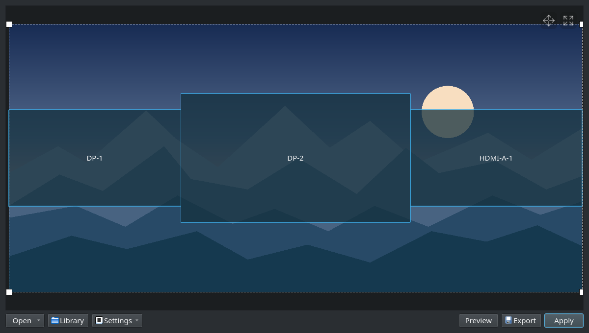

# Wallpaper Splitter

[](https://github.com/kstorbakken/wallpaper_splitter/actions/workflows/ci.yml)

> [!NOTE]
> This is an independent fork of the original
> [Wallpaper Splitter](https://github.com/l0drex/wallpaper_splitter) project.
> It contains additional maintenance and feature work, but is not an official
> continuation of or endorsed by the original project.

On KDE it is not possible to apply an image so that it spans across all of your screens.
This tool fixes that by splitting your image according to your screen setup.
It can also directly apply the image as your wallpaper.
The supported desktop target is **KDE Plasma 6 on Wayland**.


Keep in mind that this only works with images, not with any fancy wallpaper engine or even dynamic wallpapers.


## 🚀 Features

This is an overview of the currently supported functionality.

- [x] Split a given image
- [x] Apply the wallpaper from within the application
- [x] Apply the wallpaper from the command line
- [x] Export with configurable filenames and collision handling
- [x] Browse, reapply, rename, and delete saved wallpaper sets
- [x] Rotate saved sets on a schedule while the app is closed
- [x] Batch split a folder into exports or saved library sets
- [x] Choose a custom library folder
- [x] Temporarily preview on the desktop and restore the previous wallpaper
- [x] Remember input and export folders
- [x] Account for physical monitor sizes and bezel gaps
- [x] Stretch the entire source image across the combined monitor layout
- [x] Adjust position
- [x] Adjust scale*
- [x] Zoom into the scene with <kbd>Ctrl</kbd> + <kbd>Mouse wheel</kbd>
- [x] Pan the zoomed preview with a middle-button drag
- [x] Command line tool
- [x] Support drag 'n drop

*there is a bug with diagonal scaling

See the [roadmap](ROADMAP.md) for ideas under consideration, including requests
originally filed in the original project's issue tracker.

## 📦 Installation

### Arch Linux (AUR)

Install [wallpaper_splitter from the AUR](https://aur.archlinux.org/packages/wallpaper_splitter)
using an AUR helper such as `yay`:

```sh
yay -S wallpaper_splitter
```

### Install a release package

Open the [latest GitHub release](https://github.com/kstorbakken/wallpaper_splitter/releases/latest)
and expand **Assets** to download the package for your distribution. The prebuilt
packages are for **x86-64** PCs (`amd64` in the Debian filename). The source code
archives are for building the application yourself.

In a terminal, change to the folder containing your download, then use the
appropriate command below. These examples use version **1.4.1**; replace the
filename with the one you downloaded.

| Distribution | Download | Install command |
| --- | --- | --- |
| Debian / compatible Ubuntu-based systems | `.deb` | `sudo apt install ./wallpaper-splitter_1.4.1_amd64.deb` |
| Fedora | `.rpm` | `sudo dnf install ./wallpaper-splitter-1.4.1-1.x86_64.rpm` |
| Arch Linux (prebuilt alternative to AUR) | `.pkg.tar.zst` | `sudo pacman -U ./wallpaper_splitter-1.4.1-1-x86_64.pkg.tar.zst` |

These package managers also install required dependencies from your configured
repositories. The `.deb` is built on **Debian 13 (Trixie)** and the `.rpm` on
Fedora; your system must provide compatible Qt 6, KDE Frameworks 6, and runtime
libraries. Older Debian/Ubuntu releases or other RPM-based distributions may not
satisfy those dependencies. If installation reports incompatible dependencies,
try the AppImage below or build from source using the instructions further down.

After installing a native package, launch **Wallpaper Splitter** from your
application menu or run `wallpaper_splitter` in a terminal. Applying wallpapers
directly requires a KDE Plasma session.

### AppImage (other distributions)

Download the `.AppImage` from the same release, then make it executable and run
it from the download folder (replace the filename for newer releases):

```sh
chmod +x wallpaper-splitter-1.4.1-x86_64.AppImage
./wallpaper-splitter-1.4.1-x86_64.AppImage
```

The AppImage bundles Qt and KDE libraries and runs without a system-wide package
installation. It is built on an Ubuntu 24.04-based KDE neon environment, so it
still requires a compatible x86-64 Linux system; older distributions may not run
it. Keep the file somewhere permanent if you plan to use it regularly. To update,
download a newer AppImage and run that file instead.

If it reports that FUSE is unavailable, try running it with extraction enabled:

```sh
APPIMAGE_EXTRACT_AND_RUN=1 ./wallpaper-splitter-1.4.1-x86_64.AppImage
```

## 💭 How to use it

1. Click <kbd>📂 Open</kbd> to select your image.
2. Resize or stretch the photo by dragging one of its corner handles. Hold <kbd>Shift</kbd> while dragging to preserve its aspect ratio. Adjust the position of your screens with <kbd>Left 🖱️</kbd> and the size with <kbd>Right 🖱️</kbd>.
   You can also zoom with <kbd>Ctrl</kbd> + <kbd>Mouse wheel</kbd> and pan the zoomed preview by holding the middle mouse button and dragging.
3. Click <kbd>Export</kbd> to save user-owned crop files, or <kbd>Apply</kbd> to
   write a managed wallpaper set and use it on the current Plasma activity.

Click the translucent stretch icon in the preview’s upper-right corner
(**Stretch across screens**) to stretch the entire original image across the
combined monitor layout, filling its width and height. This changes the image’s
proportions when its aspect ratio differs from the layout. Monitor positions and
physical bezel gaps are preserved; image content in gaps or outside the panels of
an uneven arrangement remains hidden. You can still adjust the image and layout
afterward. Click the active icon again to restore the original image and the
monitor layout shown when it was first loaded.

The adjacent outward-arrow icon, **Fill panorama**, scales one continuous image
proportionally to fill the complete monitor arrangement. Excess content is cropped
symmetrically at the top/bottom or sides; the image is never repeated or stretched.
Monitor positions and physical bezel gaps stay intact. Both actions start from the
original image. The active icon stays highlighted; click it again to return to
the initially loaded view, or click the other icon to switch modes. Loading a
new image clears the active mode.

Choose <kbd>Open → Split folder…</kbd> to process every supported image directly
inside a folder. Select **Export** or **Library (save without applying)**, then
choose centered largest fit, stretch, or panorama for each image. Physical monitor
settings, image format, JPEG quality, and the export filename template are reused.
The batch destination, layout, collision choice, and folders are remembered as
defaults for the next batch, including after restarting the app. Each image is
fitted automatically; manual crop positioning from the editor is not copied.
Subfolders are excluded. Export to a different folder to keep source images safe.
Batch exports default to creating revisions, and offer replace or skip on collisions.
Cancel stops before the next image and keeps completed output; the final summary
lists failures and skipped images.

Click <kbd>Preview</kbd> to temporarily apply the current crop to the desktop.
The editor minimizes while a countdown and **End Preview** button are shown.
The previous wallpaper returns after **15 seconds** by default, when you end the
preview, or when you close the preview dialog. Change **Preview duration** in
<kbd>Settings → General</kbd> (1–300 seconds). Preview uses temporary crops and
does not add a set to the library or write to your export folder. Temporary files
are removed after Plasma confirms restoration; if restoration fails, the dialog
keeps them and offers another attempt. The application's slideshow cannot switch
wallpapers during a preview. Other activities' wallpapers are left as they were.

Use <kbd>Settings → General</kbd> to choose the remembered input and export folders, the
export filename template, image format and JPEG quality, and what happens when an export
already exists. Automatic format keeps PNG sources lossless, uses high-quality JPEG for
opaque photographic sources, and always uses PNG when transparency is present. The source
image is never modified.
Uncheck **Close the app after successfully applying a wallpaper set** to keep
the window open for further adjustments after Apply. This preference is remembered;
closing after Apply is enabled by default.
Templates support `{source}`, `{screen}`, `{number}`, `{revision}`, and
`{digest}`.

Set **Library folder** in <kbd>Settings → General</kbd> to choose a different
location for managed sets. Apply, the Library, batch saves, and slideshow rotation
all use that location. Existing sets stay in their original folder; switch back
to access them. If you switch to another library, choose its sets in the slideshow
playlist before resuming rotation. **Restore Defaults** returns to the standard
library folder and resets the remembered batch choices and preview duration.

Use <kbd>Library</kbd> to browse saved sets, with a preview, source image path,
creation time, monitor layout, crop mappings, and generated file paths. Reapply
requires the saved monitor positions and resolutions to match the current layout;
the original source image is not needed. Export saves a set's existing crops using
the configured export folder, filename template, and collision handling, without
reopening or recropping the source. Renaming changes the library label.
Deletion removes only managed files and is blocked while Plasma references a set
on any activity, or when those references cannot be checked. Switch those activities
to another wallpaper before deleting. Exports and source images are kept.

### Library slideshow

Open **Library → Slideshow…** to build a playlist from saved sets:

1. Check the sets to include. Drag them into order, or use **Move up** and **Move down**.
2. Choose an interval from **1 to 10080 minutes** (one week). The default is 30 minutes.
3. Optionally enable **Shuffle** to choose randomly, avoiding consecutive repeats
   when more than one usable set is available.
4. Check **Rotate automatically while logged in** and click **Save**. You can then
   close Wallpaper Splitter. The first scheduled change happens after the interval.

**Next now** applies the next saved playlist entry immediately, even with automatic
rotation off. Save playlist edits before using it. To stop rotation, uncheck
**Rotate automatically while logged in** and click **Save**; the current wallpaper
stays in place. Do this before uninstalling the app too.

Each switch reapplies a complete set to whichever **Plasma activity is active at
that moment**. Other activities keep their wallpapers. Saved monitor positions and
resolutions must match the connected layout. Missing, damaged, deleted, and
incompatible sets are skipped; if none are usable, the wallpaper stays unchanged.
Deleting a set does not delete its playlist entry: uncheck the missing entry and
save to remove it. Original source images are not needed.

Automatic rotation requires a **systemd user session integrated with the graphical
desktop**. The app installs a user timer and a short-lived service, without root
access or an always-running Wallpaper Splitter process. The timer starts with the
graphical session, stops at logout, and does not wake the computer or replay missed
slides after sleep. It waits the selected interval between scheduled runs; a manual
**Next now** does not reset that timer. Systems without systemd can still save a
playlist and use **Next now**.

For **AppImage** installations, keep the AppImage in a permanent location. After
moving it or switching to a new AppImage filename, launch that AppImage and click
**Save** in the Slideshow dialog to update the scheduled command.
If you launched it with `APPIMAGE_EXTRACT_AND_RUN=1` to work around missing FUSE,
the saved service preserves that setting.

The dialog shows the last switch attempt and any saved error. **Refresh status**
checks the timer again; clicking **Save** repairs or restarts its configuration.
For scheduler or launch failures, inspect the user service:

```sh
systemctl --user status wallpaper-splitter-slideshow.timer wallpaper-splitter-slideshow.service
journalctl --user -u wallpaper-splitter-slideshow.service -n 30
```

Playlist settings and playback state are stored in
`~/.config/wallpaper-splitter/slideshow.json`. Generated timer/service files live in
`~/.config/systemd/user/wallpaper-splitter-slideshow.{timer,service}`. These paths
respect `XDG_CONFIG_HOME`. Turning automatic rotation off and clicking **Save**
stops the timer and removes its startup link and both generated unit files.
Your playlist and playback state are kept for manual use or enabling rotation again.

### Physical monitor sizes

Open <kbd>Settings → Monitors</kbd> and enable **Use physical monitor sizes** when displays
have different pixel densities, uneven heights, or bezel gaps. Enter each panel's diagonal in inches, or its
visible width and height in millimeters. Reported dimensions are starting values;
verify them against your displays. If dimensions are unavailable, the dialog
starts with a 24-inch estimate.

Adjust **Left** and **Top** in millimeters to match the panels' real positions,
including bezel gaps. Positive top offsets move a panel down. Initial positions
follow the desktop arrangement; **Arrange left to right, top aligned** gives a
simple side-by-side starting point. The dialog previews the physical arrangement.

#### Example: same size, different resolutions

For two **27-inch, 16:9** monitors, one **1920 × 1080** and one **3840 × 2160**:

1. Enable **Use physical monitor sizes** and enter **27** in both Diagonal fields.
   Both panels should have the same width and height. Equal diagonals only imply
   equal dimensions when the aspect ratios match; use measured visible dimensions
   if needed, excluding the frame.
2. Click **Arrange left to right, top aligned** for a side-by-side starting point.
3. Adjust **Left** and **Top** to match the actual positions, as described below.
4. Click **OK**, review the crop overlay, and apply the wallpaper.

Both monitors now cover equally sized areas of the wallpaper. An object crossing
the seam keeps the same physical size even though one display has more pixels.
You do not need to change either monitor's resolution or desktop scaling.

#### Example: bezel gaps and height differences

Positions share a common origin; use **Left = 0, Top = 0** for the left panel.
If its visible width is **600 mm** and the distance from its visible right edge to
the next panel's visible left edge is **12 mm**, set the next panel's **Left = 612**.
Include both bezels and any space between them in that gap. The matching strip of
wallpaper is hidden so lines continue naturally across it.

If the right panel sits **10 mm higher**, set its **Top = -10**; if it sits
**10 mm lower**, use **Top = 10**. This works for monitors with identical sizes
and resolutions too. A wallpaper with a clear line crossing the screens can help
you check alignment and fine-tune the measurements.

These instructions are also available through **How to line up monitors** in
the Monitors dialog.

Measurements are remembered per monitor, including disconnected displays. A
reported serial number identifies the monitor across ports; displays without a
unique serial use their connector. Saved dimensions rotate when a display moves
between landscape and portrait. Applying monitor settings or changing the display
layout refits and recenters the crop overlay; review the preview before applying.

Physical sizing affects both the GUI and command-line crops when enabled. Plasma's
display configuration is unchanged. Turn the option off to return to the normal
desktop-coordinate layout. Saved library sets retain their original crop mappings.

Preferences follow the XDG base-directory convention and are stored in
`~/.config/wallpaper-splitter/settings.conf`. Existing preferences from older
versions are migrated automatically. Managed wallpaper sets created by
<kbd>Apply</kbd> or a library batch are stored in `~/.local/share/wallpaper-splitter/sets`
by default, or in your configured library folder.

## Command line

Advance a saved Library slideshow without opening a window:

```sh
wallpaper_splitter --slideshow-next
```

This works even when automatic rotation is off. It cannot be combined with an
input image or export/apply options. The timer uses `--slideshow-tick`, which does
nothing when automatic rotation is disabled. Both commands exit after one attempt.

Passing an image starts the command-line exporter. Without `--destination`,
files are written to an `<image>_split` directory beside the source image.

```sh
wallpaper_splitter --destination ~/Pictures/spanned wallpaper.jpg
wallpaper_splitter --filename-template '{source}-{screen}' \
  --collision revision wallpaper.jpg
wallpaper_splitter --format png --destination ~/Pictures/lossless wallpaper.jpg
```

`--format` accepts `automatic`, `jpeg`, or `png`. Use `--jpeg-quality` with a value
from 1 to 100 to override the saved JPEG quality.

Use `--apply` to write a managed set and apply it to the current Plasma
activity. Export-only options cannot be combined with `--apply`.

```sh
wallpaper_splitter --apply wallpaper.jpg
```

Add `--stretch-across-screens` to stretch the entire source image across the combined
monitor layout, including when physical sizing is enabled:

```sh
wallpaper_splitter --stretch-across-screens --destination ~/Pictures/spanned wallpaper.jpg
wallpaper_splitter --stretch-across-screens --apply wallpaper.jpg
```

Use `--fill-panorama` for a continuous, proportional panorama instead.
The two automatic layout options cannot be combined with each other or with
`--top-left` or `--bottom-right`. Without either option,
the existing command-line positioning and sizing behavior is unchanged.

## ⚙️ How does it work

Opening and splitting the image is straightforward. Exports remain owned by
the user. Applied crops and their JSON manifest are kept in the application's
local data directory so Plasma always references persistent files.

Applying the image is done via a D-Bus call to the Plasma Shell,
for more on that see their documentation provided [here](https://develop.kde.org/docs/plasma/scripting/api/).


## 🛠️ Build and test

Wallpaper Splitter requires a C++20 compiler, CMake 3.20 or newer, Qt 6, and
KDE Frameworks 6 ConfigWidgets. Building the tests also requires Qt 6 Qml
(`qt6-declarative` on Arch, `qt6-declarative-dev` on Debian).
Source installations also need Qt's Wayland and image-format plugins for native
Wayland startup and formats such as WebP; see [DEVELOPMENT.md](DEVELOPMENT.md).

```sh
cmake -S . -B build -DCMAKE_BUILD_TYPE=Release -DBUILD_TESTING=ON
cmake --build build
ctest --test-dir build --output-on-failure
```

To install it after building:

```sh
cmake --install build
```

An optional Arch Linux devcontainer provides the complete build environment
used by the maintainer. It can also produce a native pacman package from the
current working tree for installation on an Arch test host. See the
[development environment guide](DEVELOPMENT.md) for setup, package output, and
adapting the container to another distribution.

For prebuilt packages and AppImage instructions, see [Installation](#-installation).


## 💡 How to help

Pull requests are welcome. See [CONTRIBUTING.md](CONTRIBUTING.md) for the
development workflow and [ROADMAP.md](ROADMAP.md) for ideas under consideration.
The long-term hope is to contribute the core multi-screen spanning capability
directly to Plasma.


## License and authors

Wallpaper Splitter is licensed under the [GNU GPL v3](LICENSE). See
[AUTHORS.md](AUTHORS.md) for project authorship and maintenance history.
